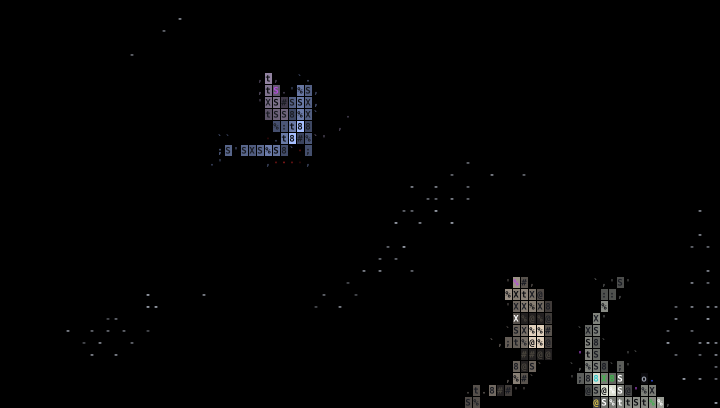
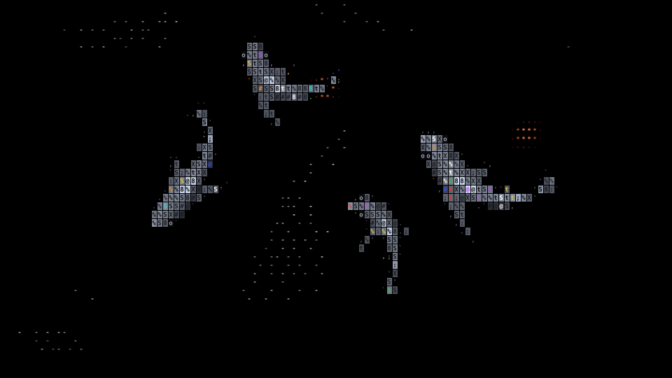
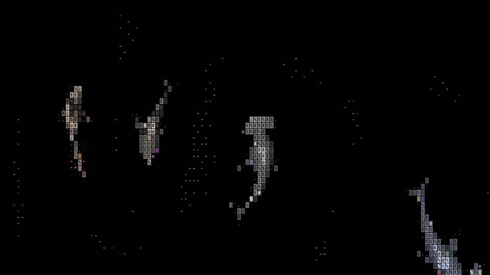
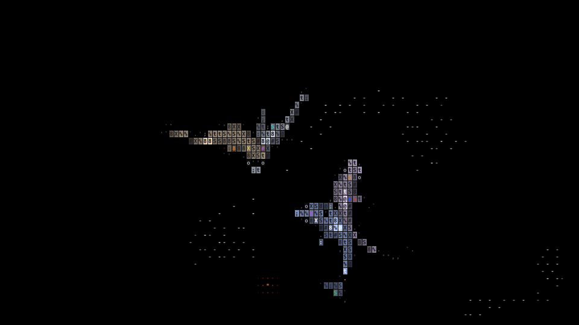

<div align="center">

# ascii-sharks-lite

**Put swimming ASCII sharks on any web page, in your terminal or in a README. One file, no build.**

[stackedlol/ascii-sharks](https://github.com/stackedlol/ascii-sharks) (1k+ stars since 19 Oct 2026) needs `npm install`, Vite and a TypeScript build before you see a fish. This is the same simulation in one script tag.

Works with **Claude Code** and **Codex**.

 



<sub>The real output of `node render.mjs --svg docs/ocean.svg --width 720 --height 405 --frames 24 --fps 12 --seed 4 --sharks hammerhead,tiger,mako,thresher`. It moves: a 2-second SVG flip-book.</sub>

</div>

## Quick start
```bash
git clone https://github.com/Dodai0419/ascii-sharks-lite && cd ascii-sharks-lite
node render.mjs --term --sharks hammerhead,tiger
```
That plays the ocean in your terminal (24-bit colour, Ctrl+C to stop). For a web page, open `index.html` by double-clicking it: there is no server and no build. Or add two lines to your own page:
```html
<ascii-ocean sharks="hammerhead,mako" style="height:60vh"></ascii-ocean>
<script src="ascii-sharks.js"></script>
```

## Gallery
All from `node render.mjs --svg ...`, at 960 x 540:

| four classics (the upstream default) | the hammerhead family |
|---|---|
|  |  |
| `--seed 1` | `--seed 5 --sharks greathammer,hammerhead,zebra,tiger` |

| thresher, mako, nurse, classic | in your terminal |
|---|---|
|  | `node render.mjs --term` draws the same cells with ANSI colours, sized to your window |
| `--seed 9 --sharks thresher,mako,nurse,classic` | |

Shark kinds: `classic hammerhead zebra tiger greathammer mako thresher nurse`. The first one listed is the biggest, and each next one is 10% smaller, the same rule as upstream's demo.

## The problem
- To see upstream's sharks you clone, run `npm install` (TypeScript and Vite, over 26 MB before their own dependencies), then `npm run dev`. You can't drop it into a plain HTML page, a blog or a CMS.
- It only runs in a browser canvas, so it can't go in a README, a terminal or a slide.
- Updating a hand-made port by hand drifts from upstream.

## The solution
| Idea | Fixes |
|------|-------|
| **One plain JS file** | The upstream `src/*.ts` with types stripped by Node's own `stripTypeScriptTypes`. Works as `<script src>`, in Node (`require`), and from `file://`. |
| **`<ascii-ocean>` element** | Two lines of HTML. It sizes itself from CSS, pauses off screen, respects `prefers-reduced-motion`, and click splashes still scatter the fish (all upstream `OceanEngine` behaviour). |
| **Headless renderer** | The same `World` and `AsciiRenderer` draw into a cell grid instead of a canvas, so you get terminal output and SVG stills or flip-books for READMEs. A fixed `--seed` gives the same image every time. |
| **Regenerated, not rewritten** | `node tools/port.mjs <upstream>/src --check` proves the core block is still exactly upstream's code. Run it without `--check` to pull new upstream changes. |

## Use with Claude Code
```bash
/plugin marketplace add Dodai0419/ascii-sharks-lite
/plugin install ascii-sharks-lite@ascii-sharks-lite
```
Then ask: "add an ASCII shark ocean behind the hero of my landing page" or "make a README banner with hammerheads".

## Use with Codex (ChatGPT)
```bash
git clone https://github.com/Dodai0419/ascii-sharks-lite && cp -r ascii-sharks-lite/skills/* ~/.codex/skills/
```
Or copy `AGENTS.md` to your project root.

## Benchmarks
Windows 11, Node 24.20. Upstream: stackedlol/ascii-sharks at commit a0074c1.

| | ascii-sharks (upstream) | ascii-sharks-lite |
|-|-|-|
| steps before the first fish | `npm install`, `npm run dev`, open localhost | open `index.html`, or add 2 lines of HTML |
| packages to install | 2 dev dependencies: typescript 5.9.3 (23.6 MB unpacked) + vite 6.4.5 (2.7 MB), not counting vite's own esbuild/rollup | 0 |
| files to ship to a page | 7 TS sources, built by Vite | 1 (`ascii-sharks.js`, 70 KB, 17.7 KB gzipped) |
| lines of simulation + renderer | 1,846 (`math, species, world, renderer, engine .ts`) | the same code: 1,812 lines after type stripping |
| total lines | 1,877 (all `.ts`/`.tsx` + demo) | 2,025 (`ascii-sharks.js` + `render.mjs`), including the terminal and SVG outputs that upstream does not have |
| outputs | browser canvas | browser canvas, terminal, SVG still, SVG flip-book |
| one still SVG, cold CLI (960 x 540, 4 s of simulation) | not available | 710-1,757 ms (3 runs) |

Package sizes come from `npm view typescript@^5.6.0 dist.unpackedSize` and `npm view vite@^6.0.0 dist.unpackedSize`. Line counts come from `wc -l`, and the CLI time from `node render.mjs --svg out.svg` timed with `date +%s%N`. Upstream's install and dev server were not run here, so their time is not measured.

The total line count is not smaller: this repo is lighter because it needs no toolchain, not because it has less code.

## Inspired by
- [stackedlol/ascii-sharks](https://github.com/stackedlol/ascii-sharks): the whole simulation (boids, hunting sharks, wakes) and the ASCII renderer, used unchanged (MIT).

## Roadmap
- [ ] `--gif` output for places that block SVG.
- [ ] A `sharks="random"` option.
- [ ] Minified `ascii-sharks.min.js` for a CDN.

## License
MIT. See `LICENSE` and `NOTICE`.
